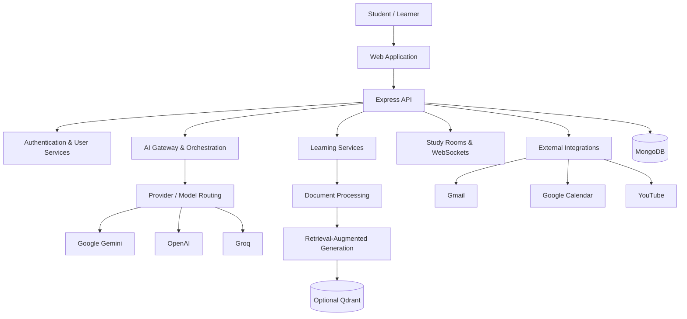

StudyVerse AI
One workspace. Every step of learning.
An AI-powered learning platform for studying, researching, collaborating, and preparing for what comes next.

  <a href="https://study-verse-ai-eight.vercel.app"><strong>↗ Explore the Live App</strong></a>
  &nbsp; · &nbsp;
  <a href="https://github.com/deepakpandit31/StudyVerseAi"><strong>View Source Code</strong></a>

  
  
  

  
  
  

The idea
Learning rarely happens in one place. Students move between notes, videos, search engines, flashcards, coding tools, calendars, and interview-preparation platforms. That constant switching can interrupt focus and make it harder to connect what they learn with what they need to do next.

StudyVerse AI brings these workflows together.

It is a full-stack learning environment that combines an AI study assistant, document intelligence, revision tools, research support, productivity features, collaborative study rooms, developer utilities, and career preparation.

The goal is not simply to generate answers. It is to help learners move from understanding → practice → revision → progress in one connected experience.
<blockquote>
  <strong>Learn with context. Practice with purpose. Make progress that lasts.</strong>
</blockquote>Product at a glance
Area	What it helps learners do
AI Study Assistant	Ask questions, understand concepts, revise, and learn through guided conversations
Study Tools	Turn learning material into summaries, flashcards, quizzes, mind maps, and study plans
Document Intelligence	Ask questions grounded in uploaded documents using retrieval-augmented generation
AI Research	Explore topics, discover educational resources, and find relevant videos
Productivity	Organize tasks, reminders, and study schedules
Study Rooms	Learn with others through shared resources and real-time communication
Developer Tools	Understand code, work through programming problems, and get coding assistance
Career Preparation	Practice interviews, evaluate answers, and review resumes
Voice & Multimedia	Use voice interaction, text-to-speech, video discovery, and image-based questions

Explore the platform
01 — Learn with an AI tutor
- Ask questions in a conversational interface.
- Use multiple tutor modes and learning approaches.
- Get beginner-friendly explanations and exam-oriented support.
- Explore Socratic learning, revision, and interview preparation.
- Continue context-aware conversations with AI memory support.
02 — Turn material into active learning
- Generate structured Study Packs.
- Summarize notes and learning resources.
- Create flashcards and AI-generated quizzes.
- Generate mind maps and study plans.
- Track progress and review learning analytics.
- Support spaced repetition and adaptive learning workflows.
03 — Ask questions about your documents
StudyVerse AI supports document-assisted learning across a range of formats.
Content type	Supported formats
Documents	PDF, DOCX, DOC
Presentations	PPTX, PPT
Text and structured data	TXT, Markdown, CSV, JSON
Visual content	Images

The documented processing workflow extracts text, cleans and chunks content, prepares searchable representations, and retrieves relevant context for RAG-based question answering.
04 — Research with context
- Get structured, AI-assisted research responses.
- Discover educational resources.
- Search for relevant videos.
- Bring research context into study workflows.
05 — Keep learning organized
- Manage todos and reminders.
- Use browser notifications.
- Plan study sessions and learning goals.
- Connect Gmail and Google Calendar when configured.
06 — Learn together
- Create and join study rooms.
- Exchange messages in real time.
- Share notes and quizzes.
- Use a room-level AI tutor.
- Communicate through WebSocket-based functionality.
07 — Build technical confidence
- Get explanations for programming concepts.
- Work through coding questions.
- Use code-related RAG context.
- Access optional local code execution where enabled.
08 — Prepare for opportunities
- Generate interview questions.
- Evaluate interview answers.
- Review resumes.
- Practice technical interview topics.
09 — Use voice and multimedia features
- Interact through voice features.
- Use text-to-speech support.
- Discover educational videos.
- Explore AI-generated interactive lessons.
- Ask questions about image-based content.
How the system is organized
StudyVerse AI separates the user-facing application from backend services, AI capabilities, learning workflows, and external integrations.

AI request lifecycle
User prompt
    │
    ▼
AI gateway
    │
    ▼
Provider and model selection
    │
    ├── Google Gemini
    ├── OpenAI
    └── Groq
    │
    ▼
AI service / orchestration
    │
    ▼
Response to the application
The shared AI layer centralizes provider configuration, model selection, fallback handling, and access to AI services.
Provider fallback
When multiple providers are configured, the application can attempt another provider according to its fallback configuration if a provider is temporarily unavailable.
Request
   │
   ▼
Primary provider
   │
   ├── Success ─────────────────► Return response
   │
   └── Temporary failure
              │
              ▼
        Configured fallback
              │
              ▼
          Return response
Document intelligence and RAG
Document upload
      │
      ▼
Text extraction
      │
      ▼
Cleaning and chunking
      │
      ▼
Embedding generation
      │
      ▼
Vector storage
      │
      ▼
Relevant context retrieval
      │
      ▼
Context-aware AI response
Document records and retrieval are associated with authenticated users to help keep one user's indexed material separate from another user's results.
Technology
Layer	Tools and technologies
Frontend	HTML5, CSS3, JavaScript, responsive UI
Backend	Node.js, Express.js
API & communication	REST APIs, WebSockets
Authentication	JWT
Database	MongoDB
AI providers	Google Gemini, OpenAI, Groq
AI architecture	Provider gateway, model routing, agent orchestration, RAG, AI memory
Document processing	PDF/DOCX/PPTX extraction, text extraction, OCR, chunking, vector search
Vector storage	Qdrant (optional)
Integrations	Gmail, Google Calendar, YouTube
Runtime	Node.js 20+

Repository layout
StudyVerseAi/
│
├── Backend/
│   ├── server.cjs
│   ├── package.json
│   ├── controllers/
│   ├── middleware/
│   ├── models/
│   ├── routes/
│   ├── services/
│   ├── utils/
│   ├── ai/
│   ├── src/
│   │   ├── ai/
│   │   ├── agents/
│   │   ├── documents/
│   │   ├── memory/
│   │   ├── observability/
│   │   ├── rag/
│   │   └── orchestrator.cjs
│   ├── tests/
│   └── smokeTest.cjs
│
├── Frontend/
│   ├── index.html
│   ├── app.js
│   ├── style.css
│   ├── dashboard.html
│   ├── dashboard.js
│   └── dashboard.css
│
├── .gitignore
├── package-lock.json
└── README.md
Run locally
Prerequisites
- Node.js 20+
- npm
- MongoDB Atlas or a local MongoDB instance
- At least one supported AI provider API key
Optional, depending on the features you configure:
- Qdrant for external vector storage
- LibreOffice for legacy .ppt extraction
- Google OAuth credentials for Gmail and Calendar integrations
- YouTube Data API key for video discovery
1. Clone the repository
git clone https://github.com/deepakpandit31/StudyVerseAi.git
cd StudyVerseAi
2. Install backend dependencies
cd Backend
npm install
3. Create your environment file
Create Backend/.env:
# Application
PORT=5050
FRONTEND_ORIGINS=http://localhost:5050,http://127.0.0.1:5050

# Database
MONGODB_URI=your_mongodb_connection_string

# Authentication
JWT_SECRET=your_long_random_secret
SESSION_SECRET=your_session_secret

# Required: configure at least one AI provider
GEMINI_API_KEY=your_gemini_api_key
GEMINI_MODEL=your_gemini_model
Optional AI providers
OPENAI_API_KEY=
OPENAI_MODEL=

GROQ_API_KEY=
GROQ_MODEL=

AI_FALLBACK_PROVIDERS=gemini,openai,groq
Optional integrations
# Qdrant
QDRANT_URL=
QDRANT_API_KEY=
QDRANT_COLLECTION=smart_study_knowledge

# Google OAuth
GOOGLE_CLIENT_ID=
GOOGLE_CLIENT_SECRET=
GOOGLE_REDIRECT_URI=http://localhost:5050/api/google/callback

# YouTube
YOUTUBE_API_KEY=
Use the exact variable names expected by the application configuration. Configure production origins and OAuth callback URLs for your deployed environment.
Keep secrets private. Never commit .env, API keys, database credentials, or session secrets. Store production values in your hosting provider's environment-variable settings.

4. Start the application
From the Backend directory:
npm start
Then open:
http://localhost:5050
Important: Run the frontend through the backend instead of opening its HTML files directly with file://. Authentication, APIs, cookies, and WebSocket features depend on the application being served correctly.
Authentication model
StudyVerse AI uses JWT-based authentication for protected application features.
Register
   │
   ▼
Login
   │
   ▼
JWT issued
   │
   ▼
Authenticated API requests
   │
   ▼
Protected application features
Protected requests use the bearer-token format:
Authorization: Bearer <token>
Authenticated workflows include AI features, document tools, RAG, quizzes, flashcards, study plans, progress tracking, todos, study rooms, and career tools.
API reference
The following is a high-level index of the documented routes. Request schemas, response formats, and additional routes should be checked in the backend implementation.

<strong>Authentication</strong>
Method	Endpoint
POST	/api/auth/register
POST	/api/auth/login
GET	/api/auth/me
POST	/api/auth/logout

<strong>AI services</strong>
Method	Endpoint
POST	/api/ai/chat
POST	/api/ai/task
GET	/api/ai/status
POST	/api/ai/test-models

<strong>Documents and RAG</strong>
Method	Endpoint
POST	/api/documents/upload
POST	/api/documents/ingest
GET	/api/documents
POST	/api/rag/query

<strong>Learning and analytics</strong>
Method	Endpoint
GET	/api/dashboard
GET / PUT	/api/users/profile
GET / POST	/api/quizzes
POST	/api/quiz-attempts/:quizId
GET	/api/progress
GET	/api/analytics/overview
GET / POST	/api/plans
POST	/api/tutor/chat

<strong>Productivity</strong>
Method	Endpoint
GET / POST / PATCH / DELETE	/api/todos

<strong>Research and media</strong>
Method	Endpoint
POST	/api/research
GET	/api/videos

<strong>Career tools</strong>
Method	Endpoint
POST	/api/coding/solve
POST	/api/interview/question
POST	/api/interview/evaluate
POST	/api/resume/review

<strong>Study rooms</strong>
Method	Endpoint
POST	/api/rooms
WebSocket	/ws

Quality checks
Run the backend QA suite from Backend:
npm run qa
Start the server and run the smoke test:
npm run smoke
To test against a specific server:
TEST_URL=http://localhost:5050 npm run smoke
The documented test coverage includes:
- Authentication and JWT protection
- AI integration and provider fallback
- Document upload and RAG user isolation
- API contracts
- CORS behavior and rate limiting
- OAuth behavior
- Frontend structure
Run the checks in your own environment after changes and before deployment.
Security and deployment notes
Security is part of the application setup, not an afterthought.
- Keep .env and credentials out of source control.
- Never expose AI provider keys in browser-side code.
- Use strong, unique JWT and session secrets.
- Restrict production CORS origins to trusted domains.
- Keep protected APIs behind authentication.
- Use HTTPS in production.
- Configure OAuth redirect URLs for the deployed application.
- Restrict WebSocket origins.
- Enforce access controls for uploaded documents and retrieval.
- Do not expose arbitrary code execution publicly without sandboxing and container isolation.
The optional code-execution feature is disabled by default.
Production deployment checklist
1. Deploy the backend to a host that supports the required Node.js runtime.
2. Configure MongoDB and the required environment variables.
3. Add credentials for at least one AI provider.
4. Set the production frontend origin in the CORS configuration.
5. Configure OAuth callback URLs if integrations are enabled.
6. Configure optional Qdrant and YouTube services if required.
7. Deploy the frontend or serve it through the backend according to your setup.
8. Enable HTTPS.
9. Confirm WebSocket support if Study Rooms are enabled.
10. Verify login, AI requests, document upload, and key learning workflows.
Browser microphone features require HTTPS or localhost.
Responsive experience
The frontend is designed for desktop, laptop, tablet, and mobile screens. The documented interface includes responsive navigation, mobile navigation, responsive dashboards, loading and disabled states, and reduced-motion support.
A learning journey in one place
Bring in your learning material
              │
              ▼
       Understand the content
              │
       ┌──────┼────────┐
       ▼      ▼        ▼
    Summary  Quiz   Flashcards
       │      │        │
       └──────┼────────┘
              ▼
          Ask the AI tutor
              │
              ▼
        Review your progress
              │
              ▼
       Refine your study plan
StudyVerse AI is designed to connect the stages of learning: understanding a topic, practicing it, revisiting it, and reflecting on progress.
Roadmap
Areas identified for future development include:
- Additional AI provider integrations
- More capable multimodal learning workflows
- More personalized learning recommendations
- Improved recommendation and analytics systems
- Additional educational integrations
- Better offline support
- A dedicated mobile application
- Expanded collaboration features
This roadmap describes potential directions, not a promise that these features are already available.
Contributors
StudyVerse AI was developed collaboratively by:
Contributor	Contribution area
Aditya Kumar	Full Stack / AI Development
Ansh Pratap	Full Stack / AI Development
Deepak Sikhwal	Full Stack MERN / AI Development

Contributions, feedback, and suggestions are welcome.
License
This project is currently intended for educational and development purposes. No open-source license is specified at this time. Add an appropriate LICENSE file before distributing the project for external use.

StudyVerse AI
Learn smarter. Practice better. Build your future.
One connected space for the way you learn.

<a href="https://study-verse-ai-eight.vercel.app"><strong>Visit StudyVerse AI ↗</strong></a>

